<div align="center">

<p align="center">
  
</p>

# 📡 Awesome Live Streaming Tech 🎥

**A Curated Ecosystem of SaaS Platforms, Self-Hosted Media Servers & Real-Time Broadcast Tools**  
*Focused on Real-Time Video Production, Sub-Second Latency, Protocol Gateways, Multistreaming & Self-Hosted Infrastructure*

<br/>

<a href="https://github.com/ishandutta2007/Awesome-Awesome-Awesome"></a><a href="https://discord.gg/jc4xtF58Ve"></a>
<a href="https://github.com/ishandutta2007/Awesome-Live-Streaming-Tech/stargazers"></a>
<a href="https://github.com/ishandutta2007/Awesome-Live-Streaming-Tech/network/members"></a>
<a href="https://github.com/ishandutta2007/Awesome-Live-Streaming-Tech/pulls"></a>
<a href="https://github.com/ishandutta2007/Awesome-Live-Streaming-Tech/blob/main/LICENSE"></a>
<a href="https://github.com/ishandutta2007"></a>

<br/>
<br/>

**SEO & Discovery Keywords**: `live streaming`, `broadcasting software`, `WebRTC`, `RTMP`, `SRT`, `HLS`, `WHIP`, `WHEP`, `OBS Studio`, `MediaMTX`, `multistreaming`, `video transcoding`, `self-hosted streaming`, `sub-second latency`, `video ingest`, `FFmpeg`, `video pipeline`

</div>

---

## 📑 Table of Contents

- [🌟 Introduction & Ecosystem Scope](#-introduction--ecosystem-scope)
- [🌐 Sector Overview & Market Dynamics](#-sector-overview--market-dynamics)
- [🏢 SaaS & Hosted Live Streaming Platforms](#-saas--hosted-live-streaming-platforms)
- [💻 Open-Source Streaming Projects (Ranked by Stars)](#-open-source-streaming-projects-ranked-by-stars)
- [⚡ Streaming Protocols Cheat Sheet](#-streaming-protocols-cheat-sheet)
- [🛠️ Architecture: DIY Self-Hosted vs Managed SaaS](#️-architecture-diy-self-hosted-vs-managed-saas)
- [🤝 How to Contribute](#-how-to-contribute)
- [💖 Support](#-support)
- [📈 Star History](#-star-history)

- [🛡️ Disclaimer & Licensing](#️-disclaimer--licensing)


---

## 🌟 Introduction & Ecosystem Scope

Live video streaming has evolved from traditional television broadcast trucks to accessible cloud studios and sovereign self-hosted media servers. Today's live streaming stack empowers solo content creators, corporate town halls, esports producers, and broadcast engineers to capture, encode, transcode, and distribute low-latency interactive video worldwide.

This repository tracks the leading **SaaS platforms** and **open-source repositories** powering:
- 🎬 **Browser-based & Desktop Production Studios** (OBS Studio, StreamYard, vMix, Ecamm Live)
- 🔁 **Cloud Multistreaming Relays** (Restream, Castr, Lightstream)
- 🖥️ **Self-Hosted Media Servers & Protocol Gateways** (MediaMTX, SRS, OvenMediaEngine, Owncast)
- ⚡ **Real-Time Interactive WebRTC & Sub-Second Latency Stacks** (LiveKit, Janus, Pion)
- ⚙️ **Foundational Media Frameworks** (FFmpeg, GStreamer, CasparCG)

---

## 🌐 Sector Overview & Market Dynamics

- **📈 Estimated Market Size**: The global live streaming market was valued at approximately **$1.49 billion in 2024** and is projected to expand to between **$4.2 billion and $5.6 billion by 2030–2032**, compounding at an annual growth rate (**CAGR of ~22.4% – 24.8%**). When paired with cloud video content delivery networks (CDN), video encoding infrastructure, and enterprise video communications, the total addressable video delivery market exceeds **$10 billion**.
- **🧩 Market Dynamics & Fragmentation**: The live streaming technology sector is **moderately to highly fragmented** across tooling, ingest protocols, and production workflows. While consumer audience distribution is concentrated in a handful of hyper-scale destinations (YouTube Live, Twitch, TikTok Live, Kick), the upstream software and infrastructure layer is contested by browser-based SaaS studios, specialized desktop switchers, and community-driven open-source servers. This prevents a single winner-take-all monopoly and drives high adoption of **hybrid workflows** combining open-source encoding (OBS, FFmpeg) with managed multi-CDN distribution (Restream, Castr, Wowza).

---

## 🏢 SaaS & Hosted Live Streaming Platforms

The following SaaS and commercial platforms provide turn-key browser studios, cloud multistreaming, enterprise paywalls, and hardware-accelerated desktop production suites.

> 📊 **Sorted Descending by Company Size / Valuation & Revenue**:

| 🏷️ Platform | 🏢 Company Size / Valuation | 💰 Starting Pricing | 🆓 Free Tier / Free Trial Limits | 🎯 Primary Architecture & Capabilities |
| :--- | :--- | :--- | :--- | :--- |
| **[Streamlabs Talk Studio](https://streamlabs.com/talk-studio)** | **$14.2B Valuation**<br/>*(Parent: Logitech / NASDAQ: LOGI; ~$4.3B Revenue)* | **$19/month**<br/>*(or $12/mo billed annually at $144/yr for Pro)* | **Free-forever plan**:<br/>• 1 destination<br/>• Up to 5 on-screen guests<br/>• 4-hour max stream duration<br/>• 720p resolution<br/>• Streamlabs watermark | Cloud-native browser broadcast studio (formerly Melon) with custom alerts, overlays, and guest screen sharing. |
| **[StreamYard](https://streamyard.com/)** | **$2.55B Valuation**<br/>*(Parent: Bending Spoons; ~$380M ARR)* | **$25/month**<br/>*(or $20/mo billed annually at $240/yr for Basic)* | **Free-forever plan**:<br/>• 20 hours/month streaming limit<br/>• Up to 6 on-screen participants<br/>• 2 recording hours/month<br/>• StreamYard watermark | Intuitive browser-based multistreaming studio with integrated banner tickers, viewer comments display, and private backstage. |
| **[Wirecast](https://www.telestream.net/wirecast/)** | **$1.0B+ Valuation**<br/>*(Parent: Telestream / Genstar Capital; ~$180M ARR)* | **$35/month** *(Studio Sub)*<br/>*or **$599** perpetual lifetime license* | **30-day free trial**:<br/>• Full access to all Pro features<br/>• Visual on-screen watermark<br/>• Periodic audio chime watermark | Enterprise-grade desktop video switcher (macOS/Windows) with multi-track audio mixing, PTZ camera control, and ISO recording. |
| **[Riverside.fm](https://riverside.fm/)** | **$180M Valuation**<br/>*(Series B led by Seven Seven Six; ~$25M ARR)* | **$19/month**<br/>*(or $15/mo billed annually at $180/yr for Standard)* | **Free-forever plan**:<br/>• 2 hours separate A/V recording<br/>• 720p max video resolution<br/>• Unlimited single-track recording<br/>• Riverside watermark on exports | High-fidelity local 4K video recording, live broadcast studio, AI text-based video editing, and automatic clip generation. |
| **[Restream](https://restream.io/)** | **$120M Valuation**<br/>*(Insight Partners / Silverton; ~$25M ARR)* | **$19/month**<br/>*(or $16/mo billed annually at $192/yr for Standard)* | **Free-forever plan**:<br/>• Simultaneous multistream to 2 channels<br/>• Restream Studio with 5 guests<br/>• Restream branding/watermark<br/>• 15-minute recording storage | Pioneer cloud multistreaming relay broadcasting to 30+ destinations simultaneously with aggregated cross-platform live chat. |
| **[BoxCast](https://www.boxcast.com/)** | **$60M Valuation**<br/>*(Updata Partners; ~$18M ARR)* | **$109/month**<br/>*(or $99/mo billed annually at $1,188/yr for Broadcaster)* | **14-day free trial**:<br/>• Full cloud transcoding access<br/>• Multistreaming to Facebook & YouTube<br/>• Embeddable HTML5 player<br/>• Automated broadcast scheduling | Automated live streaming workflow for municipal governments, houses of worship, and enterprise events with hardware encoder integration. |
| **[Dacast](https://www.dacast.com/)** | **$30M Valuation**<br/>*(Private / bootstrapped; ~$22M ARR)* | **$39/month**<br/>*(billed annually at $468/yr Starter plan, 2.4 TB/yr)* | **14-day free trial**:<br/>• 10 GB test bandwidth<br/>• 20-min max stream duration/session<br/>• Full paywall and monetization testing<br/>• White-label HTML5 player | Enterprise video hosting and live broadcasting platform with multi-CDN delivery (Akamai), paywall monetization, and DRM security. |
| **[vMix](https://www.vmix.com/)** | **$20M Valuation**<br/>*(StudioCoast PTY Ltd; ~$15M ARR)* | **$60 one-time** *(Basic HD)*<br/>*or **$50/month** (Max Sub)* | **60-day free trial**:<br/>• Unrestricted access to vMix Pro<br/>• Up to 4K resolution & 1,000 inputs<br/>• Up to 8 guests via vMix Call<br/>• Zero watermarks | Windows-native live production suite leveraging GPU acceleration for instant replay, NDI input/output, SRT, and virtual sets. |
| **[Lightstream Studio](https://golightstream.com/)** | **$15M Valuation**<br/>*(Parent: SplitmediaLabs / XSplit; ~$12M ARR)* | **$8/month**<br/>*(or $7/mo billed annually at $84/yr for Gamer 720p)* | **7-day free trial**:<br/>• Full cloud mixing capabilities<br/>• Direct Xbox & PlayStation capture<br/>• Custom cloud overlays & scenes<br/>• 1080p 60fps streaming | Cloud mixing console for console gamers; injects overlays, webcams, and alerts directly from the cloud without capture cards or a PC. |
| **[Castr](https://castr.com/)** | **$10M Valuation**<br/>*(Independent / bootstrapped; ~$8M ARR)* | **$14.99/month**<br/>*(or $12.50/mo billed annually at $150/yr for Multistream)* | **7-day free trial**:<br/>• Multistream to 5 social channels<br/>• 1,000 GB test bandwidth<br/>• Multi-CDN ingest (Akamai, CloudFront)<br/>• 24/7 linear playout testing | Multi-CDN live video hosting, SRT/RTMP ingest, 24/7 pre-recorded linear video scheduling, and multistreaming with 99.9% SLA. |
| **[Ecamm Live](https://www.ecamm.com/)** | **$8M Valuation**<br/>*(Ecamm Network, LLC; ~$6M ARR)* | **$20/month**<br/>*(or $16/mo billed annually at $192/yr for Standard)* | **14-day free trial**:<br/>• Full multi-destination streaming<br/>• Custom overlays and scenes<br/>• Virtual webcam and microphone<br/>• Ecamm on-screen watermark | macOS-exclusive live production software optimized for Apple Silicon with Elgato Stream Deck integration, virtual camera, and isolated audio ISO. |

---

## 💻 Open-Source Streaming Projects (Ranked by Stars)

Self-hosted projects give developers and broadcasters complete sovereignty over video pipelines, zero per-minute cloud fees, customizable protocol conversion, and transparent data privacy.

> ⭐ **Sorted Descending by Real-Time GitHub Star Count**:

### 1. 🥇 [OBS Studio](https://github.com/obsproject/obs-studio) [](https://github.com/obsproject/obs-studio/stargazers)
- **Description**: The industry-standard open-source desktop software for video recording and live broadcasting. Features modular dockable UI, unlimited audio/video scenes and sources, GPU-accelerated compositing, studio mode, and deep plugin extensibility.
- **Protocols Supported**: RTMP, RTMPS, SRT, WHIP (WebRTC HTTP Ingestion Protocol), HLS.
- **Tech Stack**: C, C++, Qt, CMake.
- **License**: GPL-2.0.

### 2. 🥈 [FFmpeg](https://github.com/FFmpeg/FFmpeg) [](https://github.com/FFmpeg/FFmpeg/stargazers)
- **Description**: The universal multimedia framework powering virtually every modern streaming engine. Delivers complete command-line tools and libraries (`libavcodec`, `libavformat`, `libavfilter`) to transcode, mux, demux, stream, filter, and play video and audio.
- **Protocols Supported**: RTMP, RTSP, HLS, DASH, SRT, WebRTC, UDP, RTP, HTTP.
- **Tech Stack**: C, Assembly.
- **License**: LGPL-2.1+ / GPL-2.0+.

### 3. 🥉 [Jitsi Meet](https://github.com/jitsi/jitsi-meet) [](https://github.com/jitsi/jitsi-meet/stargazers)
- **Description**: Fully encrypted, 100% open-source WebRTC video conferencing and interactive multi-user streaming platform. Features Jibri for automated recording and live streaming to YouTube or custom RTMP endpoints.
- **Protocols Supported**: WebRTC, RTMP (via Jibri), SCTP, RTP/SRTP.
- **Tech Stack**: JavaScript, React, Java, Go.
- **License**: Apache-2.0.

### 4. 🚀 [SRS (Simple Realtime Server)](https://github.com/ossrs/srs) [](https://github.com/ossrs/srs/stargazers)
- **Description**: Industrial-grade, high-efficiency real-time video server designed for high-concurrency live broadcasting. Acts as a high-performance protocol bridge between RTMP, WebRTC, HLS, HTTP-FLV, and SRT with low CPU and memory footprints.
- **Protocols Supported**: RTMP, WebRTC, HLS, HTTP-FLV, SRT, GB28181.
- **Tech Stack**: C++, Go.
- **License**: MIT.

### 5. ⚡ [LiveKit](https://github.com/livekit/livekit) [](https://github.com/livekit/livekit/stargazers)
- **Description**: High-performance open-source WebRTC SFU (Selective Forwarding Unit) and real-time infrastructure. Enables developers to build ultra-low latency interactive live streaming, spatial audio, telephony, and bidirectional AI video agents.
- **Protocols Supported**: WebRTC, WHIP, WHEP, RTMP Ingress/Egress, SIP.
- **Tech Stack**: Go, TypeScript, Rust.
- **License**: Apache-2.0.

### 6. 🔄 [MediaMTX](https://github.com/bluenviron/mediamtx) [](https://github.com/bluenviron/mediamtx/stargazers)
- **Description**: Ready-to-use, zero-dependency real-time media server and protocol converter in a single binary. Ingests any media stream and instantly republishes it across multiple outgoing protocols with hot reloading, disk recording, and Prometheus metrics.
- **Protocols Supported**: RTSP, RTMP, HLS, WebRTC (WHEP/WHIP), SRT, LL-HLS.
- **Tech Stack**: Go.
- **License**: MIT.

### 7. 🌐 [Pion WebRTC](https://github.com/pion/webrtc) [](https://github.com/pion/webrtc/stargazers)
- **Description**: Pure Go implementation of the WebRTC API. Unlocks custom SFUs, WebRTC-to-RTSP bridges, recording nodes, and headless streaming proxies without external C/C++ dependencies.
- **Protocols Supported**: WebRTC, DTLS, ICE, RTP, RTCP, SCTP.
- **Tech Stack**: Go.
- **License**: MIT.

### 8. 🛡️ [nginx-rtmp-module](https://github.com/arut/nginx-rtmp-module) [](https://github.com/arut/nginx-rtmp-module/stargazers)
- **Description**: The classic Nginx extension module providing RTMP live streaming, video on demand, HLS packaging, and stream relaying. The battle-tested foundation for DIY broadcast relay servers worldwide.
- **Protocols Supported**: RTMP, HLS, MPEG-DASH.
- **Tech Stack**: C.
- **License**: BSD-2-Clause.

### 9. 💬 [Owncast](https://github.com/owncast/owncast) [](https://github.com/owncast/owncast/stargazers)
- **Description**: Autonomous self-hosted live video and web chat server. Delivers a turn-key "personal Twitch" experience directly to your viewers with custom branding, moderation bots, and decentralized ActivityPub / Fediverse federation.
- **Protocols Supported**: RTMP ingest, HLS playback, ActivityPub federation.
- **Tech Stack**: Go, Preact.
- **License**: MIT.

### 10. 🚪 [Janus WebRTC Gateway](https://github.com/meetecho/janus-gateway) [](https://github.com/meetecho/janus-gateway/stargazers)
- **Description**: General-purpose WebRTC server engineered by Meetecho. Modular C architecture with plugins for video rooms, audio bridges, SIP gateways, streaming relays, and screen sharing.
- **Protocols Supported**: WebRTC, RTP, RTCP, RTSP, SIP.
- **Tech Stack**: C.
- **License**: GPL-3.0.

### 11. 📦 [Node-Media-Server](https://github.com/illuspas/Node-Media-Server) [](https://github.com/illuspas/Node-Media-Server/stargazers)
- **Description**: Lightweight Node.js media server implementation supporting RTMP, HTTP-FLV, WebSocket-FLV, and HLS. Perfect for integrating live streaming directly into Node.js application backends.
- **Protocols Supported**: RTMP, HTTP-FLV, WS-FLV, HLS, DASH.
- **Tech Stack**: JavaScript, Node.js.
- **License**: MIT.

### 12. 🐳 [datarhei Restreamer](https://github.com/datarhei/restreamer) [](https://github.com/datarhei/restreamer/stargazers)
- **Description**: Complete Docker-based live streaming GUI solution. Ingests video from webcams, IP cameras, OBS, or RTMP and restreams it directly to YouTube, Twitch, Facebook, or custom websites with a modern web dashboard.
- **Protocols Supported**: RTMP, SRT, RTSP, HLS, WebRTC (WHEP).
- **Tech Stack**: Go, TypeScript, Docker.
- **License**: Apache-2.0.

### 13. 🎛️ [Streamlabs Desktop](https://github.com/streamlabs/desktop) [](https://github.com/streamlabs/desktop/stargazers)
- **Description**: Open-source desktop broadcast client built on the OBS engine and Electron. Bundles built-in chat overlay widgets, selective recording, tips integration, and multistreaming setups.
- **Protocols Supported**: RTMP, RTMPS, SRT.
- **Tech Stack**: TypeScript, C++, Electron.
- **License**: GPL-3.0.

### 14. 🏎️ [Ant Media Server](https://github.com/ant-media/Ant-Media-Server) [](https://github.com/ant-media/Ant-Media-Server/stargazers)
- **Description**: Ultra-low latency streaming engine offering scalable WebRTC, CMAF, and HLS delivery. Provides sub-0.5s video playback latency, adaptive bitrate streaming, and autoscaling support on AWS and Kubernetes.
- **Protocols Supported**: WebRTC, RTMP, RTSP, SRT, HLS, CMAF.
- **Tech Stack**: Java.
- **License**: Apache-2.0 (Community Edition).

### 15. 🔴 [Red5 Server](https://github.com/Red5/red5-server) [](https://github.com/Red5/red5-server/stargazers)
- **Description**: The veteran open-source Java media server that pioneered RTMP streaming outside of Adobe Flash Media Server. Supports audio/video streaming, multi-user gaming, and recording.
- **Protocols Supported**: RTMP, RTSP, HLS, WebSockets.
- **Tech Stack**: Java, Spring.
- **License**: Apache-2.0.

### 16. 🍳 [OvenMediaEngine](https://github.com/OvenMediaLabs/OvenMediaEngine) [](https://github.com/OvenMediaLabs/OvenMediaEngine/stargazers)
- **Description**: Sub-second latency streaming server designed for massive multi-viewer interactive broadcasts. Ingests via WebRTC, SRT, or RTMP and delivers sub-second streams via WebRTC and Low-Latency HLS (LL-HLS) to HTML5 players.
- **Protocols Supported**: WebRTC, LL-HLS, RTMP, SRT, RTSP, MPEG-2 TS.
- **Tech Stack**: C++.
- **License**: GPL-2.0.

### 17. 📺 [CasparCG Server](https://github.com/CasparCG/server) [](https://github.com/CasparCG/server/stargazers)
- **Description**: Professional broadcast graphics and video playout server deployed 24/7 by national television networks (including Sweden's SVT). Renders real-time dynamic HTML5 and Flash motion graphics with SDI/NDI output.
- **Protocols Supported**: SDI, NDI, RTSP, UDP, Screen playout.
- **Tech Stack**: C++.
- **License**: GPL-3.0.

### 18. 🏚️ [Muxshed (shed)](https://github.com/muxshed/shed) [](https://github.com/muxshed/shed/stargazers)
- **Description**: Self-hosted broadcast server delivering "one stream in, every destination, no cloud middleman." Features public watch pages, multi-layer scene compositing, 24/7 looping channels, and Stream Deck companion controls.
- **Protocols Supported**: RTMP, FLV, HLS, WebRTC guest links.
- **Tech Stack**: Rust, FFmpeg.
- **License**: AGPL-3.0.

### 19. 🎥 [VideoWhisper Live Streaming](https://github.com/videowhisper/videowhisper-webrtc) [](https://github.com/videowhisper/videowhisper-webrtc/stargazers)
- **Description**: Open-source WordPress live streaming plugin and WebRTC HTML5 broadcasting application. Powers turnkey multi-channel video portals, 24/7 TV channels, and interactive webcam communities.
- **Protocols Supported**: WebRTC, RTMP, RTSP, HLS, MPEG-DASH.
- **Tech Stack**: PHP, JavaScript (React).
- **License**: GPL-2.0.

---

## ⚡ Streaming Protocols Cheat Sheet

Choosing the correct protocol is essential for balancing latency, firewall traversal, quality, and platform compatibility:

| 📡 Protocol | ⏱️ Typical Latency | 🚚 Transport Layer | 🏆 Best Use Case | ⚠️ Trade-offs |
| :--- | :--- | :--- | :--- | :--- |
| **WebRTC / WHIP / WHEP** | **< 500 ms** *(Sub-second)* | UDP (SRTP / SCTP) | Interactive talk shows, auctions, live gaming, remote guests | Higher server CPU overhead; complex scaling without SFUs |
| **SRT (Secure Reliable Transport)** | **0.5 s – 2 s** *(Low)* | UDP (Error Recovery) | First-mile broadcast ingest over unpredictable public internet | Requires SRT listener/caller endpoints; less native browser playback |
| **RTMP / RTMPS** | **2 s – 5 s** *(Traditional)* | TCP | Legacy ingest standard for YouTube, Twitch, and Facebook Live | Flash legacy; lack of native browser HTML5 playback without transcoding |
| **LL-HLS (Low Latency HLS)** | **1 s – 3 s** *(Near Real-Time)* | HTTP/2 or HTTP/3 (TCP/QUIC) | Scalable iOS & Safari delivery, mass spectator sports | Sensitive to chunk pipeline timings; CDN caching configuration complexity |
| **Standard HLS / DASH** | **6 s – 30 s** *(High)* | HTTP/1.1 or HTTP/2 (TCP) | Global scale distribution via standard HTTP caching CDNs | High latency unsuited for real-time live viewer interactions |

---

## 🛠️ Architecture: DIY Self-Hosted vs Managed SaaS

```
               ┌────────────────────────────────────────────────────────┐
               │              FIRST-MILE PRODUCTION / INGEST            │
               │   OBS Studio / vMix / StreamYard / Hardware Encoders   │
               └───────────────────────────┬────────────────────────────┘
                                           │
                    ┌──────────────────────┴──────────────────────┐
                    │                                             │
           [Self-Hosted DIY Stack]                     [Managed Cloud SaaS]
                    │                                             │
                    ▼                                             ▼
       ┌────────────────────────┐                    ┌────────────────────────┐
       │ MediaMTX / SRS / FFmpeg│                    │ Restream / Castr / CDN │
       │ Protocol Demuxing      │                    │ Automated Cloud Relay  │
       └────────────┬───────────┘                    └────────────┬───────────┘
                    │                                             │
      ┌─────────────┴─────────────┐                               │
      ▼                           ▼                               ▼
┌───────────┐               ┌───────────┐           ┌───────────────────────────┐
│  WebRTC   │               │ LL-HLS    │           │ Multi-Destination Egress: │
│ (<500ms)  │               │ CDN Cache │           │ YouTube, Twitch, Kick,    │
│ Direct P2P│               │ Mass Scale│           │ Facebook Live, Custom RTMP│
└───────────┘               └───────────┘           └───────────────────────────┘
```

- **Choose SaaS (StreamYard, Restream, Dacast)** when your primary goal is running high-production live shows with guest interviewees without managing server firewalls, bandwidth billing spikes, or multi-CDN failovers.
- **Choose Self-Hosted (MediaMTX, SRS, Owncast, LiveKit)** when you require absolute data sovereignty, low sub-second latency, internal corporate firewall broadcasting, zero per-viewer SaaS fees, or custom WebRTC application pipelines.

---

## 🤝 How to Contribute

We actively welcome contributions to enrich this open ecosystem guide!

1. 🍴 **Fork the repository** to your GitHub account.
2. 🌿 **Create a new branch**: `git checkout -b feature/add-streaming-tool`.
3. ✍️ **Add or update entries** in `README.md`:
   - Follow the established formatting (Markdown table for SaaS, ranked sections for Open-Source).
   - Provide concrete pricing, specific trial limits, and exact GitHub star links.
4. 🔍 **Verify links and formatting**.
5. 🚀 **Submit a Pull Request** with a descriptive summary of your additions.

---

## 💖 Support

A heartfelt thank you to everyone exploring, using, and contributing to **Awesome Live Streaming Tech**! If this repository has helped you navigate the live video landscape, architect streaming pipelines, or discover powerful open-source broadcasting tools, please consider supporting the project:

- ⭐ **Star this repository** on GitHub to boost visibility.
- 🍴 **Fork and share** with fellow developers, creators, and broadcast engineers.
- 📢 **Spread the word** across communities on Discord, Reddit, LinkedIn, and X (Twitter).
- ☕ **Buy me a coffee / Sponsor**: Support ongoing curation, updates, and research by visiting the [Sponsor Dashboard](https://github.com/sponsors/ishandutta2007).

<p align="left">
  <a href="https://github.com/sponsors/ishandutta2007">
    
  </a>
</p>

---

## 📈 Star History

[](https://star-history.dera.page/#ishandutta2007/Awesome-Live-Streaming-Tech&type=date&legend=top-left)

---

## 🛡️ Disclaimer & Licensing

- **Disclaimer**: This directory is curated for research, educational, and developer reference. Inclusion does not imply official commercial endorsement. Always ensure streaming productions comply with third-party platform terms of service, local privacy regulations (GDPR/CCPA), and copyright licensing requirements.
- **License**: Released under the [MIT License](LICENSE).

---

<div align="center">

**Made with ❤️ for streamers, video engineers, DevOps architects, and the open-source multimedia community.**  
⭐ Star this repo if you find it helpful!

</div>
